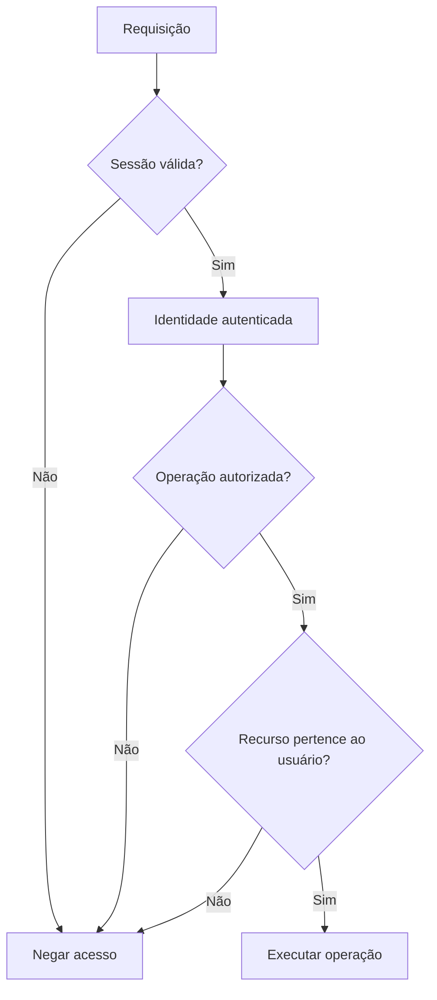

# ADR-002 — Autenticação, autorização e propriedade dos recursos

* **Status:** Aceito
* **Data:** 2026-10-18
* **Projeto:** Sistema Currículo

## 1. Contexto

O Sistema Currículo mantém informações pessoais, acadêmicas e profissionais
dos estudantes, além de currículos, documentos e associações com vagas.

Esses recursos não podem ser tratados apenas com base em identificadores
informados pelo cliente. O sistema precisa distinguir três responsabilidades:

- autenticar quem está realizando a requisição;
- autorizar quais operações essa identidade pode realizar;
- verificar se o recurso acessado pertence ao estudante autenticado.

O requisito funcional RF13 exige autenticação para acesso às informações
pessoais e aos currículos do estudante.

O requisito não funcional RNF04 estabelece que dados pessoais, currículos e
associações com vagas devem ser protegidos e acessíveis somente por usuários
autorizados.

O documento `requisitos-seguranca.md` também define como princípio que a
autorização deve considerar a propriedade do recurso e que o backend não deve
confiar exclusivamente em identificadores fornecidos pelo cliente.

A implementação atual utiliza sessão autenticada e disponibiliza a identidade
validada do estudante para as operações protegidas.

Este ADR registra a estratégia arquitetural utilizada pelo projeto para
autenticação, autorização e propriedade dos recursos.

## 2. Decisão

Será adotada uma estratégia composta por três etapas independentes e
complementares:

1. autenticação da identidade;
2. autorização da operação;
3. verificação da propriedade do recurso.

Uma requisição a recurso protegido somente deve prosseguir quando as
verificações aplicáveis forem satisfeitas.



## 3. Autenticação

### 3.1. Credenciais

A autenticação principal do estudante utiliza e-mail e senha.

A senha não deve ser armazenada em texto puro. O mecanismo de armazenamento
deve utilizar representação derivada adequada, conforme as regras de segurança
do projeto.

Após a validação das credenciais, o sistema estabelece uma sessão autenticada.

### 3.2. Sessão

A sessão é representada por uma credencial opaca entregue ao cliente por meio
de cookie protegido.

O contrato atual utiliza o cookie:

```text
__Host-sessao
```

com os atributos de segurança definidos no contrato de credenciais, incluindo:

```text
Secure
HttpOnly
SameSite=Lax
Path=/
```

O token da sessão não deve ser armazenado em `localStorage`,
`sessionStorage` ou estado persistente acessível por JavaScript.

O valor bruto do token não deve ser persistido diretamente. A validação utiliza
a representação derivada do token registrada no servidor.

### 3.3. Identidade autenticada

Depois da validação da sessão, o backend disponibiliza internamente o
identificador do usuário autenticado.

Na implementação atual, essa identidade é disponibilizada por:

```python
request.state.usuario_id
```

Esse valor deve ser obtido do mecanismo de autenticação.

Identificadores recebidos pela URL, query string ou corpo da requisição não
devem substituir a identidade autenticada.

Assim, uma requisição não deve ser considerada autorizada apenas porque o
cliente informou um `usuario_id`.

## 4. Autorização

Autenticação e autorização possuem responsabilidades diferentes.

A autenticação responde:

> Quem está realizando a requisição?

A autorização responde:

> Essa identidade pode executar esta operação?

O backend deve realizar a autorização antes de permitir operações sobre
recursos protegidos.

O comportamento padrão para recursos privados deve ser de negação quando não
existir autorização válida.

Rotas públicas devem ser explicitamente definidas.

No estado atual do contrato de sessão, são previstas como públicas operações
necessárias para entrada ou funcionamento básico da aplicação, como cadastro,
login, logout, documentação da API e verificações operacionais definidas pela
aplicação.

As demais operações privadas devem exigir uma sessão válida.

## 5. Propriedade dos recursos

A autenticação válida não concede acesso automático a todos os recursos do
sistema.

Depois de identificar o estudante, o backend deve verificar se o recurso
acessado pertence a ele sempre que a operação for restrita ao proprietário.

Exemplo conceitual:

```text
Usuário autenticado: A

Currículo 10 → proprietário A → permitido
Currículo 20 → proprietário B → negado
```

A mesma regra deve ser considerada para recursos privados relacionados à conta,
incluindo, conforme aplicável:

- dados pessoais;
- formações;
- experiências;
- competências;
- projetos acadêmicos;
- documentos complementares;
- currículos e suas versões;
- associações entre currículo e vaga;
- demais informações privadas vinculadas ao estudante.

A verificação deve ser realizada no backend.

Alterar um identificador enviado pelo cliente não pode permitir acesso aos
recursos de outro estudante.

## 6. Local da verificação

A autenticação da sessão deve ocorrer na borda comum da aplicação antes da
execução das operações protegidas.

A identidade resultante deve ser encaminhada para a camada responsável pela
operação.

As regras de propriedade não devem depender apenas do handler HTTP.

Quando a propriedade fizer parte da regra de aplicação, o caso de uso deve
comparar o recurso solicitado com o usuário autenticado antes de realizar a
operação.

Dessa forma:

```text
Middleware / mecanismo de autenticação
        ↓
identidade autenticada
        ↓
API
        ↓
caso de uso
        ↓
verificação de propriedade
        ↓
persistência
```

Essa separação evita que a segurança dependa exclusivamente da interface HTTP.

## 7. Identidade informada pelo cliente

O sistema não deve confiar em um identificador de usuário enviado pelo cliente
como prova de identidade.

Por exemplo, em uma rota conceitual:

```text
PUT /estudantes/{usuario_id}
```

o valor de `{usuario_id}` pode ser utilizado para identificar o recurso
solicitado, mas deve ser comparado com a identidade proveniente da sessão.

Conceitualmente:

```text
usuario_id da rota == usuario_id autenticado
```

Somente a presença do identificador correto na URL não representa autorização.

Para operações que não precisam receber o proprietário explicitamente, deve-se
preferir utilizar diretamente a identidade autenticada.

## 8. Falhas de acesso

As falhas devem diferenciar, quando adequado ao contrato público da operação,
problemas de autenticação e problemas de autorização.

### 8.1. Usuário não autenticado

Quando uma operação protegida é solicitada sem uma sessão válida, a requisição
deve ser rejeitada antes da execução do caso de uso.

O contrato atual utiliza:

```text
401 Unauthorized
```

para falhas de autenticação.

### 8.2. Usuário autenticado sem autorização

Quando uma sessão é válida, mas a operação não é permitida para aquela
identidade, o acesso deve ser negado.

O contrato atual possui operações em que a tentativa de acessar recurso de
outro estudante é representada como:

```text
403 Forbidden
```

Entretanto, algumas operações da aplicação podem deliberadamente tratar
recurso inexistente e recurso pertencente a outro usuário de maneira
indistinguível, evitando revelar a existência do recurso.

Nesses casos, a resposta pública pode utilizar:

```text
404 Not Found
```

desde que essa decisão seja aplicada de maneira consistente no contrato da
operação.

Portanto, este ADR não determina que toda falha de propriedade obrigatoriamente
retorne o mesmo status HTTP.

A regra arquitetural é que a operação seja negada sem exposição indevida do
recurso.

## 9. RBAC e papéis de acesso

O documento `requisitos-seguranca.md` prevê a possibilidade de autorização
baseada em papéis, incluindo conceitos como `USER` e `ADMIN`.

Entretanto, os contratos e a implementação atuais de sessão não atribuem um
papel ou conjunto de permissões à identidade autenticada.

Por esse motivo, este ADR não considera RBAC como uma funcionalidade já
implementada.

A estratégia adotada na versão atual é:

```text
identidade autenticada
        +
autorização da operação
        +
propriedade do recurso
```

Um modelo RBAC poderá ser incorporado futuramente caso o projeto consolide
papéis diferentes e permissões específicas.

Nesse cenário, a propriedade continuará sendo necessária para operações
restritas ao dono do recurso.

Possuir um papel não deverá implicar automaticamente acesso irrestrito aos
dados pessoais de outros usuários.

## 10. Negação por padrão

Recursos privados devem seguir o princípio de negação por padrão.

Uma rota só deve ser pública quando essa condição estiver explicitamente
definida.

A inclusão de uma nova rota pública deve ser uma decisão consciente e não uma
consequência da ausência de proteção.

O objetivo é evitar que novas funcionalidades se tornem acessíveis sem
autenticação por esquecimento de configuração.

## 11. Princípio do menor privilégio

Usuários e componentes devem possuir somente o nível de acesso necessário para
executar suas responsabilidades.

Um estudante autenticado não recebe acesso geral aos dados de outros
estudantes.

Da mesma forma, uma futura função administrativa deverá possuir permissões
específicas e não deve representar acesso irrestrito por padrão.

## 12. Consequências

### Consequências positivas

A estratégia permite separar claramente autenticação, autorização e propriedade.

A aplicação não depende de identificadores enviados pelo cliente para
estabelecer identidade.

As regras de propriedade permanecem protegidas mesmo quando diferentes
interfaces consumirem os mesmos casos de uso.

A negação por padrão reduz o risco de exposição acidental de novas rotas.

A estratégia também permite adicionar futuramente um modelo baseado em papéis
sem substituir a verificação de propriedade existente.

### Custos e limitações

Cada operação sobre recurso privado precisa considerar explicitamente a
propriedade do recurso.

As diferentes camadas precisam preservar corretamente a identidade autenticada
durante a execução da operação.

A existência de regras distribuídas entre autenticação comum e casos de uso
exige testes específicos para impedir regressões de autorização.

Um futuro modelo RBAC exigirá nova decisão ou evolução deste ADR quando papéis
e permissões forem efetivamente definidos.

## 13. Verificação

A decisão deve ser verificável por testes que cubram, conforme a operação:

- requisição sem sessão válida;
- sessão desconhecida, expirada ou revogada;
- sessão válida;
- acesso do proprietário ao próprio recurso;
- tentativa de acesso a recurso de outro estudante;
- impossibilidade de substituir a identidade autenticada por identificadores
  enviados pelo cliente;
- ausência de execução ou alteração de estado quando a autorização falhar.

Testes unitários devem utilizar doubles determinísticos quando necessário.

Testes de integração que envolvam persistência ou a composição completa do
sistema devem seguir o ambiente de testes definido pelo projeto.

## 14. Decisões que permanecem pendentes

Este ADR não define como decisões implementadas:

- papéis e permissões definitivos de um modelo RBAC;
- existência definitiva de papel administrativo;
- autenticação por Google ou outros provedores;
- autenticação multifator;
- política definitiva de recuperação e alteração de senha;
- proteção CSRF adicional;
- limites de tentativas de autenticação;
- regras administrativas de acesso a dados pessoais;
- regras de autorização de funcionalidades opcionais ainda não consolidadas.

Esses itens devem possuir definição própria quando forem incorporados ao
produto.

## 15. Referências

- `ADR-001-arquitetura-do-sistema.md`
- `../requisitos_funcionais.md`
- `../requisitos_nao_funcionais.md`
- `../requisitos-seguranca.md`
- `../contrato-credenciais-sessao.md`
- `../../AGENTS.md`

## 16. Relação com requisitos

Esta decisão atende principalmente:

- **RF13** — autenticação para acesso às informações pessoais e currículos;
- **RNF04** — segurança e autorização sobre dados pessoais, currículos e
  associações;
- requisitos de autenticação e autorização documentados em
  `requisitos-seguranca.md`.

O ADR complementa o `ADR-001`, detalhando uma decisão que naquele documento
permanecia pendente: a estratégia específica de autenticação, autorização e
propriedade dos recursos.
