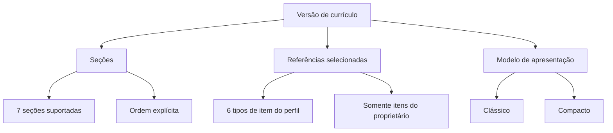

# ADR-003 — Seções, referências selecionáveis e modelos de currículo

* **Status:** Aceito
* **Data:** 2026-10-25
* **Projeto:** Sistema Currículo

## 1. Contexto

O Sistema Currículo permite que um estudante mantenha diferentes versões de
currículo utilizando informações previamente cadastradas em seu perfil.

Uma versão precisa definir de forma consistente:

- quais seções podem aparecer no currículo;
- em que ordem essas seções são apresentadas;
- quais tipos de itens do perfil podem ser selecionados para compor a versão;
- quais modelos de apresentação podem ser escolhidos.

Sem uma definição centralizada, diferentes camadas poderiam utilizar nomes,
ordens e tipos incompatíveis, causando divergência entre domínio, API,
persistência, frontend, prévia e exportação.

O requisito funcional RF05 prevê a organização das seções do currículo.

O RF06 determina que o sistema disponibilize modelos de currículo para seleção.

O RF07 estabelece a visualização do currículo utilizando as informações
cadastradas e o modelo escolhido.

Este ADR registra as decisões arquiteturais consolidadas para seções,
referências selecionáveis e modelos de uma versão de currículo.

## 2. Decisão

O currículo utilizará vocabulários fechados e explícitos para:

1. seções;
2. tipos de referências selecionáveis;
3. modelos de apresentação.

Esses vocabulários devem permanecer centralizados no domínio e ser utilizados
pelas demais camadas quando aplicável.



## 3. Seções do currículo

As seções suportadas pelo currículo são representadas pelo vocabulário
`SecaoCurriculo`.

A versão atual reconhece exatamente as seguintes seções:

| Identificador | Seção |
|---|---|
| `dados-pessoais` | Dados pessoais |
| `formacao-academica` | Formação acadêmica |
| `experiencias-profissionais` | Experiências profissionais |
| `projetos-academicos` | Projetos acadêmicos |
| `competencias` | Competências |
| `idiomas` | Idiomas |
| `documentos-complementares` | Documentos complementares |

Textos livres não devem ser utilizados como novos identificadores de seção sem
uma alteração explícita desse vocabulário.

## 4. Ordem padrão das seções

Quando o estudante ainda não definiu uma ordem própria, o currículo utiliza a
seguinte sequência:

1. dados pessoais;
2. formação acadêmica;
3. experiências profissionais;
4. projetos acadêmicos;
5. competências;
6. idiomas;
7. documentos complementares.

A ordem padrão é uma decisão explícita do domínio e não deve depender da ordem
em que os valores foram declarados no código.

## 5. Personalização da ordem

Uma versão de currículo pode possuir uma ordem própria das seções.

Ao alterar a ordem, todas as seções suportadas devem continuar presentes
exatamente uma vez.

Portanto, uma ordem válida:

- contém as sete seções suportadas;
- não duplica nenhuma seção;
- não omite nenhuma seção;
- não adiciona identificadores desconhecidos.

Exemplo válido:

```text
dados-pessoais
experiencias-profissionais
formacao-academica
projetos-academicos
competencias
idiomas
documentos-complementares
```

A reordenação modifica apenas a apresentação da versão e não altera os dados
originais do perfil.

## 6. Persistência da ordem

A ordem das seções pertence à versão de currículo.

Na persistência atual ela é armazenada no próprio registro do currículo pelo
campo:

```text
ordem_secoes
```

A representação persistida utiliza os identificadores das seções em uma
sequência textual.

Ao reconstruir o agregado, os valores são novamente convertidos para o
vocabulário `SecaoCurriculo`.

Essa estratégia mantém a decisão de ordenação vinculada a cada versão sem
duplicar os dados do perfil.

## 7. Referências selecionáveis

Uma versão de currículo não copia diretamente para o agregado todos os dados
dos itens do perfil.

Em vez disso, mantém referências tipadas para os itens selecionados.

O contrato interno utiliza `ReferenciaCurriculo`.

São selecionáveis exatamente os seguintes tipos:

| Tipo público | Identidade do domínio |
|---|---|
| `formacao_academica` | `FormacaoAcademicaId` |
| `experiencia_profissional` | `ExperienciaProfissionalId` |
| `projeto_academico` | `ProjetoAcademicoId` |
| `competencia` | `CompetenciaId` |
| `idioma` | `IdiomaId` |
| `documento` | `DocumentoId` |

O conjunto atual não inclui automaticamente outros itens existentes no perfil.

A inclusão de um novo tipo selecionável exige alteração explícita do contrato
de referência e das camadas que o persistem ou expõem.

## 8. Dados pessoais e referências

A seção de dados pessoais possui tratamento diferente dos demais itens.

Dados pessoais fazem parte da composição do currículo, mas não são
representados por uma `ReferenciaCurriculo`.

As referências selecionáveis representam itens reutilizáveis que possuem
identidade própria.

Por isso existe diferença entre:

```text
Seção do currículo
```

e:

```text
Tipo de item selecionável
```

Existem sete seções suportadas, mas seis tipos atuais de referência
selecionável.

## 9. Propriedade das referências

Uma versão de currículo só pode selecionar itens pertencentes ao mesmo
estudante proprietário da versão.

Conceitualmente:

```text
proprietário do item == proprietário do currículo
```

Uma referência válida estruturalmente não é suficiente para autorizar sua
inclusão.

A aplicação deve resolver a propriedade do item e impedir a inclusão de
informações pertencentes a outro estudante.

Essa regra evita que o conhecimento de um UUID permita montar currículo com
dados de terceiros.

## 10. Não duplicidade

A mesma referência não pode ser incluída duas vezes na mesma versão.

Uma referência é determinada pelo tipo do item e por sua identidade.

Exemplo:

```text
formacao_academica + UUID A
```

não pode aparecer repetidamente na mesma versão.

Itens diferentes do mesmo tipo continuam permitidos.

Por exemplo, duas formações acadêmicas diferentes podem compor o mesmo
currículo quando possuírem identificadores distintos.

## 11. Persistência das referências

A implementação atual utiliza a estrutura `curriculo_itens` para persistir a
seleção das versões.

Cada seleção mantém:

| Campo | Função |
|---|---|
| `curriculo_id` | identifica a versão |
| `tipo` | identifica o tipo do item |
| `item_id` | identifica o item selecionado |

A combinação desses valores representa a referência persistida.

A persistência utiliza os mesmos seis tipos reconhecidos pelo contrato de
`ReferenciaCurriculo`.

Essa estrutura permite que uma versão selecione itens reutilizáveis sem copiar
integralmente seus dados para o registro do currículo.

## 12. Seleção e desseleção

A inclusão e a remoção de referências são operações independentes da criação
dos itens do perfil.

Selecionar um item:

- não cria uma nova formação, experiência, projeto, competência, idioma ou
  documento;
- não altera o conteúdo do item original;
- apenas registra que aquela versão utiliza a referência.

Desselecionar um item:

- remove a referência daquela versão;
- não exclui o item original do perfil;
- não afeta outras versões que utilizem o mesmo item.

Essa separação permite a reutilização das informações do estudante em
diferentes currículos.

## 13. Modelos de currículo

Os modelos de apresentação suportados são representados pelo vocabulário
`ModeloCurriculo`.

A versão atual possui dois modelos:

| Identificador | Modelo |
|---|---|
| `classico` | Clássico |
| `compacto` | Compacto |

Esses identificadores devem permanecer estáveis entre as camadas que precisam
representar a escolha do modelo.

## 14. Responsabilidade do modelo

O modelo define a apresentação do currículo.

Ele não altera:

- o proprietário da versão;
- os itens selecionados;
- os dados originais do perfil;
- a ordem das seções;
- as regras de negócio dos itens.

Assim, a mesma seleção de informações pode ser apresentada utilizando modelos
diferentes.

Conceitualmente:

```text
Conteúdo da versão
        +
Ordem das seções
        +
Modelo
        =
Apresentação do currículo
```

## 15. Alteração do modelo

A edição de uma versão deve aceitar somente modelos pertencentes ao vocabulário
suportado.

Na implementação atual, a edição utiliza `ModeloCurriculo` e rejeita valores
desconhecidos.

Adicionar um novo modelo exige:

1. incluir um identificador estável no vocabulário de modelos;
2. disponibilizar sua apresentação nas camadas responsáveis;
3. garantir que prévia e exportação compreendam o novo modelo;
4. incluir os testes pertinentes.

A simples gravação de um texto diferente no campo `layout` não deve ser
considerada suficiente para tornar um modelo oficialmente suportado.

## 16. Estado atual da criação de versões

A decisão arquitetural estabelece `ModeloCurriculo` como o vocabulário oficial
dos modelos suportados.

Entretanto, na implementação atual, existe uma diferença entre os contratos de
criação e edição da versão:

- a edição já utiliza diretamente `ModeloCurriculo`;
- a criação ainda recebe `layout` como texto limitado por tamanho.

Essa diferença deve ser tratada como uma lacuna de alinhamento da implementação
e não como autorização para modelos arbitrários.

Enquanto essa diferença existir, este ADR registra como modelos oficialmente
suportados somente:

```text
classico
compacto
```

A adequação da rota de criação ao mesmo vocabulário pode ser realizada em uma
alteração técnica própria.

## 17. Separação entre conteúdo e apresentação

As informações do estudante permanecem independentes do modelo de currículo.

Essa decisão permite:

- reutilizar o mesmo item em várias versões;
- alterar o modelo sem editar os dados profissionais;
- alterar a ordem das seções sem duplicar informações;
- manter diferentes currículos utilizando combinações diferentes de referências.

O currículo funciona como uma composição das informações selecionadas, e não
como uma cópia independente de todos os dados do estudante.

## 18. Consequências positivas

A utilização de vocabulários fechados reduz divergências entre camadas.

A ordem das seções pode variar por versão sem alterar os dados originais.

Itens do perfil podem ser reutilizados em vários currículos.

O uso de referências evita duplicação desnecessária de conteúdo no agregado.

A verificação de propriedade impede seleção de dados pertencentes a outro
estudante.

Os modelos `classico` e `compacto` passam a possuir identificadores
arquiteturalmente explícitos.

A inclusão futura de novas seções, referências ou modelos passa a exigir uma
alteração deliberada do contrato.

## 19. Custos e limitações

Vocabulários fechados exigem alteração coordenada quando uma nova seção ou
modelo é introduzido.

Adicionar um novo tipo selecionável pode exigir mudanças no domínio, API,
persistência, prévia e exportação.

A estrutura atual de referências reconhece seis tipos e não inclui
automaticamente outros itens que possam existir ou surgir no perfil.

A criação de currículo ainda precisa ser completamente alinhada ao vocabulário
fechado de modelos definido neste ADR.

## 20. Verificação

A decisão deve permanecer verificável por testes que cubram, conforme
aplicável:

- aceitação das sete seções conhecidas;
- rejeição de seção desconhecida;
- rejeição de ordem com seção ausente;
- rejeição de ordem com seção repetida;
- persistência e recuperação da ordem;
- inclusão dos seis tipos de referência permitidos;
- rejeição de tipos de referência desconhecidos;
- prevenção de referência duplicada;
- rejeição de item pertencente a outro estudante;
- desseleção sem exclusão do item original;
- aceitação dos modelos `classico` e `compacto`;
- rejeição de modelo desconhecido nos contratos que já utilizam
  `ModeloCurriculo`.

Alterações exclusivamente documentais deste ADR não exigem novos testes de
código quando não modificarem o comportamento existente.

## 21. Decisões fora deste ADR

Este ADR não define:

- estilo visual detalhado de cada modelo;
- tipografia, cores ou espaçamentos dos currículos;
- criação de novos modelos além de `classico` e `compacto`;
- seleção automática de itens do perfil;
- uso de inteligência artificial para decidir quais itens incluir;
- novas seções ainda não pertencentes a `SecaoCurriculo`;
- novos tipos selecionáveis além dos seis definidos em `ReferenciaCurriculo`;
- política de exclusão dos itens originais do perfil;
- política de atualização automática de currículos quando o item original é
  alterado.

Esses pontos exigem decisões próprias quando forem incorporados ao produto.

## 22. Referências

- `ADR-001-arquitetura-do-sistema.md`
- `ADR-002-autenticacao-autorizacao-propriedade.md`
- `../requisitos_funcionais.md`
- `../modelagem_der.md`
- `../../src/backend/domain/curriculo.py`
- `../../src/backend/domain/secao_curriculo.py`
- `../../src/backend/domain/modelo_curriculo.py`
- `../../src/backend/domain/value_objects.py`
- `../../src/backend/api/versao_curriculo.py`
- `../../src/backend/api/itens_versao_curriculo.py`
- `../../src/backend/infrastructure/persistence/sqlalchemy/curriculo.py`

## 23. Relação com requisitos

Esta decisão atende principalmente:

- **RF03** — centralização das informações do estudante para uso nos currículos;
- **RF05** — estruturação e organização das seções do currículo;
- **RF06** — disponibilização de modelos de currículo;
- **RF07** — visualização do currículo utilizando informações e modelo
  selecionados;
- **RF14** — manutenção de múltiplas versões de currículo;
- **RF15** — seleção de versões para exportação ou associação com vagas.

## 24. Rastreabilidade

- **Issue:** #426 — F12.7
- **WBS:** 1.1.2.4, 1.8.2.1–1.8.2.4
- **Decisões consolidadas:** seções, ordem, referências selecionáveis e modelos
  de currículo.
