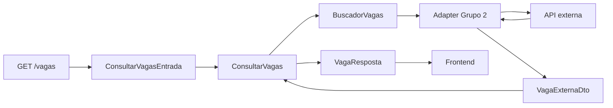

# ADR-004 — Integração com o Grupo 2 e contrato de busca de vagas

* **Status:** Aceito
* **Data:** 2026-10-25
* **Projeto:** Sistema Currículo

## 1. Contexto

O Sistema Currículo precisa consultar oportunidades de vagas disponibilizadas
por um serviço externo associado ao Grupo 2.

O RF10 estabelece que o sistema deve consultar uma ferramenta de busca de vagas
por meio de API e processar a lista retornada.

O RF11 determina que os resultados dessa busca sejam apresentados ao estudante.

Para evitar que regras internas dependam diretamente do formato de transporte do
Grupo 2, o projeto utiliza uma porta interna de busca e um DTO canônico de vaga.

A integração precisa definir de forma explícita:

- quais parâmetros de busca são aceitos pela interface atual;
- como esses parâmetros são encaminhados ao serviço externo;
- quais campos representam uma vaga dentro do Sistema Currículo;
- como respostas externas são convertidas para o modelo interno;
- quais diferenças entre o contrato externo e o modelo interno devem ser
  absorvidas pelo adapter;
- quais decisões da integração ainda permanecem pendentes entre as equipes.

Este ADR registra essas decisões conforme o comportamento atualmente
implementado.

## 2. Decisão

A integração com vagas externas seguirá uma arquitetura baseada em adapter.

A camada Application depende somente da abstração `BuscadorVagas`.

O cliente concreto do Grupo 2 é responsável por:

1. transformar os critérios internos em parâmetros da requisição externa;
2. executar a comunicação HTTP;
3. interpretar o JSON recebido;
4. validar os campos essenciais;
5. normalizar diferenças do payload;
6. produzir objetos `VagaExternaDto`;
7. traduzir falhas externas para erros conhecidos pela aplicação.



## 3. Contrato interno de busca

A Application utiliza a porta:

```text
BuscadorVagas
```

A operação conceitual é:

```text
buscar_vagas(termo, filtros)
```

e devolve:

```text
list[VagaExternaDto]
```

A Application não deve conhecer:

- URL do Grupo 2;
- biblioteca HTTP;
- estrutura exata do JSON externo;
- headers de transporte;
- política concreta de conexão;
- detalhes de serialização do provedor.

Essas responsabilidades pertencem ao adapter de infraestrutura.

## 4. Parâmetros de busca públicos

A interface HTTP atual expõe:

```text
GET /vagas
```

com os seguintes parâmetros:

| Parâmetro | Tipo | Obrigatório | Significado |
|---|---|---:|---|
| `termo` | string | Não | Texto livre para pesquisa por cargo, empresa ou palavra-chave |
| `localizacao` | string | Não | Filtro por cidade, estado ou informação geográfica |
| `modalidade` | string | Não | Filtro pela modalidade de trabalho |

Quando `termo` não é informado, o valor utilizado é uma string vazia.

`localizacao` e `modalidade` somente entram no conjunto de filtros quando
estiverem presentes na requisição.

## 5. Representação interna dos critérios

A Application recebe os critérios em `ConsultarVagasEntrada`.

Conceitualmente:

```text
termo
+
filtros
```

O termo é armazenado separadamente.

Os demais filtros são representados por um dicionário.

Na interface HTTP atual, esse dicionário pode conter:

```text
localizacao
modalidade
```

A utilização de um mapa interno permite evolução futura da integração sem
acoplar o caso de uso a uma classe específica para cada fornecedor.

Entretanto, essa flexibilidade interna não significa que qualquer filtro seja
parte do contrato HTTP público.

Os filtros públicos atualmente definidos são somente `localizacao` e
`modalidade`.

## 6. Encaminhamento ao Grupo 2

O adapter HTTP converte o termo e os filtros em parâmetros de query string.

Exemplo conceitual:

```text
?termo=python&localizacao=Sao+Paulo&modalidade=REMOTO
```

O termo somente é enviado quando possuir conteúdo após remoção dos espaços
externos.

Filtros cujo valor seja `null` não devem ser enviados.

O adapter deve realizar a codificação apropriada dos parâmetros antes da
requisição HTTP.

## 7. Modelo interno de vaga

O Sistema Currículo utiliza `VagaExternaDto` como representação canônica de uma
vaga obtida por integração.

O modelo possui oito campos:

| Campo | Tipo interno | Significado |
|---|---|---|
| `id` | string | Identificador externo e estável da vaga |
| `titulo` | string | Título da oportunidade |
| `empresa` | string | Empresa responsável pela vaga |
| `descricao` | string | Descrição da oportunidade |
| `requisitos` | tupla de strings | Requisitos informados para a vaga |
| `localizacao` | string | Informação de localização |
| `modalidade` | string | Modalidade de trabalho |
| `url_candidatura` | string | Endereço relacionado à candidatura ou detalhes |

O identificador externo é tratado como texto.

O sistema não exige que o identificador fornecido pelo Grupo 2 seja um UUID.

## 8. Campos essenciais do payload externo

Para que uma vaga externa seja convertida em `VagaExternaDto`, o adapter atual
exige valores textuais não vazios para:

- `id`;
- `titulo`;
- `empresa`.

O campo:

```text
descricao
```

também deve existir como valor textual válido.

Quando esses requisitos mínimos não são atendidos, a resposta é considerada
incompatível com o contrato esperado.

## 9. Requisitos

O campo externo:

```text
requisitos
```

é convertido para:

```text
tuple[str, ...]
```

no modelo interno.

Quando o Grupo 2 devolver uma lista ou tupla, os valores válidos são convertidos
para texto e armazenados na tupla interna.

Quando `requisitos` estiver ausente, nulo ou em formato incompatível, o adapter
atual utiliza uma coleção vazia.

Assim, a Application pode trabalhar sempre com uma coleção de requisitos, sem
precisar distinguir `null` de lista vazia.

## 10. Campos complementares

Os campos:

- `localizacao`;
- `modalidade`;
- `url_candidatura`;

são tratados defensivamente pelo adapter.

Quando estiverem ausentes ou nulos no payload externo, são normalizados para
string vazia no `VagaExternaDto`.

Essa decisão mantém o DTO interno com tipos simples e evita que a camada
Application precise conhecer diferenças de preenchimento do serviço externo.

Na interface HTTP pública, esses campos são apresentados pelo DTO de resposta e
podem ser tratados como informações complementares.

## 11. Mapeamento do Grupo 2 para o modelo interno

O mapeamento principal é:

| Campo Grupo 2 | Campo interno |
|---|---|
| `id` | `VagaExternaDto.id` |
| `titulo` | `VagaExternaDto.titulo` |
| `empresa` | `VagaExternaDto.empresa` |
| `descricao` | `VagaExternaDto.descricao` |
| `requisitos` | `VagaExternaDto.requisitos` |
| `localizacao` | `VagaExternaDto.localizacao` |
| `modalidade` | `VagaExternaDto.modalidade` |
| `url_candidatura` | `VagaExternaDto.url_candidatura` |

O mapeamento pertence à infraestrutura.

Entidades e casos de uso internos não devem processar diretamente o JSON do
Grupo 2.

## 12. Formatos de resposta tolerados

O adapter atual suporta de forma defensiva mais de uma estrutura raiz.

### Lista direta de vagas

```json
[
  {
    "id": "vaga-001",
    "titulo": "Estágio Backend",
    "empresa": "Empresa Exemplo",
    "descricao": "Desenvolvimento de serviços.",
    "requisitos": ["Python"]
  }
]
```

### Objeto contendo `vagas`

```json
{
  "vagas": [
    {
      "id": "vaga-001",
      "titulo": "Estágio Backend",
      "empresa": "Empresa Exemplo",
      "descricao": "Desenvolvimento de serviços.",
      "requisitos": ["Python"]
    }
  ]
}
```

### Objeto contendo `associacoes`

O adapter também tolera:

```json
{
  "associacoes": [
    {
      "vaga": {
        "id": "vaga-001",
        "titulo": "Estágio Backend",
        "empresa": "Empresa Exemplo",
        "descricao": "Desenvolvimento de serviços.",
        "requisitos": ["Python"]
      }
    }
  ]
}
```

Nesse formato, a vaga é extraída do campo `vaga`.

A tolerância a esses formatos pertence ao adapter e não significa que todos
eles sejam considerados formatos oficiais definitivos da API do Grupo 2.

O contrato definitivo entre as equipes deve preferir um formato único quando
essa definição externa estiver consolidada.

## 13. Resultado interno da busca

Depois do mapeamento, o restante da aplicação trabalha somente com objetos
`VagaExternaDto`.

O resultado público de:

```text
GET /vagas
```

contém:

| Campo | Significado |
|---|---|
| `termo` | termo utilizado na pesquisa |
| `filtros` | filtros aplicados |
| `total` | quantidade de vagas retornadas |
| `vagas` | vagas convertidas para o contrato HTTP interno |

Quando nenhuma vaga é encontrada, a operação continua sendo considerada uma
busca válida.

O resultado utiliza:

```text
200 OK
```

com:

```json
{
  "termo": "python",
  "filtros": {
    "modalidade": "REMOTO"
  },
  "total": 0,
  "vagas": []
}
```

Os critérios informados são preservados para que a interface possa apresentá-los
ao estudante.

## 14. Sugestão de vaga não é associação automática

O resultado retornado pela integração representa uma oportunidade encontrada.

A existência de uma vaga na busca não cria automaticamente uma associação
currículo-vaga.

Uma associação persistida continua dependendo de ação explícita do estudante,
conforme as regras funcionais do projeto.

Portanto:

```text
resultado de busca
        ≠
associação persistida
```

Essa separação evita que a integração externa modifique automaticamente o estado
dos currículos do estudante.

## 15. Identidade da vaga

O identificador da vaga externa deve ser preservado como texto.

Essa identidade pode posteriormente ser utilizada pela funcionalidade de
associação currículo-vaga.

O Sistema Currículo não deve converter arbitrariamente esse identificador para
UUID.

A interpretação e geração do identificador permanecem responsabilidade do
serviço externo.

## 16. Falhas de integração

O adapter deve traduzir falhas externas para erros conhecidos da Application.

As categorias atualmente utilizadas são:

### Timeout ou indisponibilidade

Representado por:

```text
TimeoutIntegracaoVagas
```

Na interface HTTP, resulta em:

```text
504 Gateway Timeout
```

### Resposta inválida

Respostas com JSON inválido, estrutura inesperada ou vaga incompatível com os
campos mínimos são representadas por:

```text
RespostaInvalidaVagas
```

Na interface HTTP, resultam em:

```text
502 Bad Gateway
```

### Outras falhas de integração

Falhas classificadas como `ErroIntegracaoVagas` também são convertidas em:

```text
502 Bad Gateway
```

Detalhes internos da infraestrutura não devem ser expostos ao estudante.

## 17. Preservação dos critérios em falhas

As exceções da Application preservam:

- `termo`;
- `filtros`.

Isso permite que camadas superiores conheçam os critérios que estavam sendo
utilizados quando a integração falhou.

A preservação desses valores também permite que uma futura interface ofereça
nova tentativa sem exigir que o estudante preencha novamente todos os
parâmetros.

## 18. Isolamento arquitetural

A dependência deve permanecer no sentido:

```text
API
 ↓
Application
 ↓
BuscadorVagas
 ↑
Adapter do Grupo 2
```

A Application não deve importar bibliotecas HTTP nem conhecer detalhes da API
externa.

O adapter concreto pode ser substituído por:

- outro fornecedor;
- test double;
- stub;
- implementação futura do Grupo 2.

desde que respeite a porta `BuscadorVagas`.

## 19. Segurança

A integração não deve expor:

- cookies de sessão do estudante;
- senha;
- token bruto de sessão;
- credenciais internas;
- segredos em logs.

O estudante precisa estar autenticado para utilizar a rota interna `GET /vagas`.

A autenticação entre o Sistema Currículo e o serviço externo é uma preocupação
separada da sessão do estudante.

## 20. Contrato ainda não consolidado entre serviços

O documento `contratos_integracao_grupo2.md` registra uma proposta inicial de
integração entre as equipes.

Algumas decisões externas ainda não devem ser tratadas como definitivas apenas
por existirem no adapter atual.

Ainda dependem de consolidação entre as equipes:

- URL real do serviço do Grupo 2;
- mecanismo de autenticação entre serviços;
- versionamento da API externa;
- paginação;
- limites máximos de resultados;
- política de tentativas;
- formato único definitivo da resposta;
- obrigatoriedade externa de `localizacao`, `modalidade` e
  `url_candidatura`;
- vocabulário fechado definitivo de modalidade;
- eventual pontuação ou justificativa de compatibilidade.

Essas definições devem provocar atualização deste ADR e do contrato de
integração quando forem aprovadas.

## 21. URL atual do adapter

O adapter possui uma URL base configurável.

O valor padrão presente no código é um endereço de exemplo utilizado como
configuração inicial.

Esse valor não deve ser interpretado como endpoint oficial aprovado do Grupo 2.

Em ambiente real, a URL deve vir da configuração correspondente à integração
efetivamente disponibilizada.

## 22. Parâmetros não definidos

O contrato HTTP interno atualmente não expõe como parâmetros públicos:

- paginação;
- página;
- quantidade por página;
- faixa salarial;
- nível de experiência;
- tecnologia específica como campo separado;
- tipo de contrato;
- ordenação;
- identificador de currículo.

Esses critérios não devem ser documentados como suportados até que existam
decisões e implementação correspondentes.

## 23. Consequências positivas

A Application permanece independente da API concreta do Grupo 2.

O modelo interno de vaga é estável mesmo que o formato externo sofra pequenas
variações.

Os parâmetros públicos ficam claramente delimitados.

Respostas malformadas são rejeitadas antes de alcançarem regras internas.

A identidade textual da vaga evita dependência de um formato de ID escolhido
pelo serviço externo.

A tolerância do adapter facilita integração enquanto o contrato externo ainda
está sendo consolidado.

## 24. Custos e limitações

A aceitação de múltiplos envelopes externos aumenta a responsabilidade do
adapter.

Enquanto o Grupo 2 não definir um único contrato definitivo, parte do código
precisa permanecer defensiva.

O uso de `dict` para filtros na Application oferece flexibilidade, mas exige
cuidado para não transformar filtros internos em contrato público
implicitamente.

O vocabulário de modalidade ainda não está fechado no domínio interno.

A configuração atual não representa autenticação definitiva entre os serviços.

## 25. Verificação

A decisão deve permanecer verificável por testes que cubram:

- encaminhamento do termo;
- encaminhamento de `localizacao`;
- encaminhamento de `modalidade`;
- busca sem filtros;
- codificação dos parâmetros na URL;
- mapeamento dos oito campos da vaga;
- requisitos como coleção;
- normalização de campos opcionais ausentes;
- lista direta de vagas;
- envelope `vagas`;
- envelope `associacoes`;
- rejeição de item sem campos essenciais;
- rejeição de JSON inválido;
- tratamento de timeout;
- tratamento de indisponibilidade;
- preservação do termo e dos filtros nas falhas;
- resposta vazia sem erro.

Alterações exclusivamente documentais deste ADR não exigem novos testes de
código quando não modificarem o comportamento existente.

## 26. Relação com documentos existentes

Este ADR complementa:

- `ADR-001-arquitetura-do-sistema.md`;
- `../contratos_integracao_grupo2.md`;
- `../requisitos_funcionais.md`.

O documento de contratos de integração continua útil para registrar a
negociação entre as equipes.

Este ADR, por sua vez, registra a decisão efetivamente adotada dentro do Sistema
Currículo para consumir a integração e proteger o domínio interno de detalhes
externos.

## 27. Referências

- `ADR-001-arquitetura-do-sistema.md`
- `../contratos_integracao_grupo2.md`
- `../requisitos_funcionais.md`
- `../../src/backend/application/consulta_vagas.py`
- `../../src/backend/application/ports.py`
- `../../src/backend/api/vagas.py`
- `../../src/backend/infrastructure/integrations/cliente_vagas_grupo2.py`
- `../../src/backend/tests/doubles/api_vagas_grupo2.py`

## 28. Relação com requisitos

Esta decisão atende principalmente:

- **RF10** — consulta de uma ferramenta externa de busca de vagas por API;
- **RF11** — apresentação dos resultados da busca de vagas;
- **RF12** — separação entre resultado externo e associação manual
  currículo-vaga;
- **RNF06** — tratamento de indisponibilidade de serviços externos.

## 29. Rastreabilidade

- **Issue:** #428 — F12.9
- **WBS:** 1.1.2.4, 1.8.2.1–1.8.2.4
- **Decisões consolidadas:** contrato interno da integração, parâmetros públicos
  de busca e mapeamento para o modelo interno de vaga.
