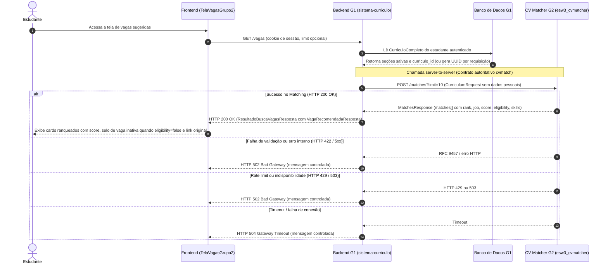

# Especificação de Contrato de Integração — Grupo 1 e Grupo 2

- **Sistema Emissor (Grupo 1):** `sistema-curriculo` (Plataforma de Apoio Profissional)
- **Sistema Integrado (Grupo 2):** `esw3_cvmatcher` (`cvmatch` — Engine de Busca e Recomendação de Vagas)
- **Autoridade do Contrato:** Decisões arquiteturais e especificação de `esw3_cvmatcher` (`POST /matches`, `GET /health`)
- **Versão do Contrato:** 2.0.0 (alinhada ao `cvmatch`)
- **Data de Atualização:** Novembro de 2026
- **Issues Relacionadas:** #173 (`[F1.6]`), #383 (`[F10.2]`)

---

## 1. Visão Geral da Integração

O **Sistema Currículo (Grupo 1)** coleta, estrutura e gerencia as informações profissionais e acadêmicas dos estudantes. Para oferecer recomendações personalizadas de oportunidades, o **backend** do `sistema-curriculo` consome a API do **CV Matcher (Grupo 2)** por comunicação **server-to-server** (sem chamadas diretas do navegador, pois CORS no `cvmatch` é desabilitado).

O frontend do `sistema-curriculo` consulta exclusivamente a rota autenticada `GET /vagas` do próprio backend, que lê o currículo do estudante autenticado, projeta apenas os campos permitidos e envia `POST /matches` ao `cvmatch`.

---

## 2. Diagrama de Sequência da Integração



---

## 3. Regras de Negócio e Fronteiras

1. **Chamada Server-to-Server e Privacidade (LGPD):**
   - O `curriculo_id` (UUID) é usado apenas no escopo da requisição, nunca sendo persistido, registrado em log ou ecoado na resposta do `cvmatch`.
   - Dados de contato/identificação (`estudante`, nome, e-mail, endereço, telefones, `titulo_versao`, `layout`, `documentos`, `cursos`, `certificacoes`) e `categoria` de competência **não** são enviados ao `cvmatch`.
2. **Parâmetro `limit`:**
   - Único query parameter aceito por `POST /matches`: inteiro entre **1** e **100** (padrão **10**, configurável via `GRUPO2_DEFAULT_LIMIT`).
   - Não há parâmetro `offset` nem filtros geográficos de elegibilidade.
3. **Vagas Inativas (`eligibility: false`):**
   - Vagas expiradas ou inativas podem aparecer após os resultados ativos com `eligibility: false` (elegibilidade de disponibilidade da vaga, nunca geográfica). A interface destaca essas vagas com selo visual de vaga encerrada ou inativa.
4. **Associação Manual:**
   - Os resultados retornados são sugestões ranqueadas; nenhuma associação currículo–vaga é persistida automaticamente na consulta.

---

## 4. Especificação do Endpoint do Grupo 2

### `POST /matches`

Query parameter: `limit` (inteiro opcional, `1 <= limit <= 100`, padrão `10`).

#### 4.1. Payload de Envio (`CurriculumRequest`, `extra="forbid"`)

```json
{
  "curriculo_id": "550e8400-e29b-41d4-a716-446655440000",
  "formacoes": [
    {
      "instituicao": "FATEC-SP",
      "curso": "Análise e Desenvolvimento de Sistemas",
      "nivel": "tecnologo",
      "status": "em_andamento",
      "inicio": "2024-02-01",
      "fim": "2026-12-01"
    }
  ],
  "experiencias": [
    {
      "empresa": "Tech Solutions",
      "cargo": "Estagiário de Desenvolvimento",
      "descricao": "Desenvolvimento de APIs REST e manutenção de banco relacional.",
      "inicio": "2025-01-01",
      "fim": null
    }
  ],
  "projetos": [
    {
      "titulo": "Sistema de Apoio Profissional",
      "descricao": "Plataforma para elaboração de currículos e busca de vagas.",
      "tecnologias": "Python, FastAPI, Docker"
    }
  ],
  "competencias": [
    { "descricao": "Python", "nivel": "intermediario" }
  ],
  "idiomas": [
    { "idioma": "Inglês", "nivel": "B2" }
  ]
}
```

#### 4.2. Payload de Resposta (`MatchesResponse`, HTTP `200 OK`)

```json
{
  "matches": [
    {
      "rank": 1,
      "job": {
        "id": 101,
        "company": "Empresa Parceira Alpha",
        "title": "Estágio em Desenvolvimento Backend Python",
        "description": "Atuação no desenvolvimento de APIs e serviços.",
        "keywords": ["API", "Backend"],
        "location": {
          "city": "São Paulo",
          "state": "SP",
          "country": "Brasil",
          "raw": "São Paulo, SP"
        },
        "work_arrangement": "HYBRID",
        "seniority_level": "INTERN",
        "skills": ["Python", "SQL"],
        "salary": { "min": 1800, "max": 2200 },
        "currency": "BRL",
        "job_url": "https://vagas.empresa-alpha.com.br/apply/101",
        "publication_date": "2026-11-01T12:00:00Z"
      },
      "score": 92.5,
      "eligibility": true,
      "matched_skills": ["Python"],
      "missing_requirements": ["SQL"],
      "embedding_model": "intfloat/multilingual-e5-small",
      "algorithm_version": "1.0.0"
    }
  ]
}
```

---

## 5. Mapeamento de Erros e Saúde

| Código no `cvmatch` | Motivo | Tradução no `sistema-curriculo` (`GET /vagas`) |
| --- | --- | --- |
| `422` (`application/problem+json`) | Payload ou `limit` inválido | `502 Bad Gateway` com mensagem segura |
| `429` (`Retry-After: 60`) | Limite global de 60 req/min | `502 Bad Gateway` com mensagem segura |
| `503` | Sobrecarga ou dependência indisponível | `502 Bad Gateway` com mensagem segura |
| Timeout / erro de rede | Tempo limite ou falha de socket | `504 Gateway Timeout` / `502 Bad Gateway` |
| `GRUPO2_API_URL` ausente | Integração não configurada no backend | `503 Service Unavailable` |

Healthcheck do `cvmatch`: `GET /health` retorna `{"status": "ok"}`.

---

## 6. Referências de Implementação

- Backend adapter: [`cliente_vagas_grupo2.py`](../src/backend/infrastructure/integrations/cliente_vagas_grupo2.py)
- Caso de uso: [`consulta_vagas.py`](../src/backend/application/consulta_vagas.py)
- API HTTP: [`vagas.py`](../src/backend/api/vagas.py)
- Composição: [`main.py`](../src/backend/main.py)
- Frontend cliente e tela: [`cliente-vagas-http.ts`](../src/frontend/features/listar-vagas/api/cliente-vagas-http.ts), [`TelaVagasGrupo2.tsx`](../src/frontend/features/listar-vagas/ui/TelaVagasGrupo2.tsx)
