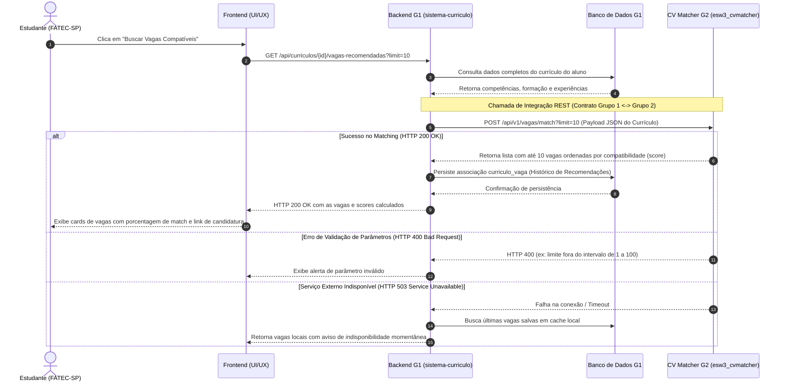

# Especificação de Contrato de Integração — Grupo 1 e Grupo 2

- **Sistema Emissor (Grupo 1):** `sistema-curriculo` (Plataforma de Apoio Profissional)
- **Sistema Integrado (Grupo 2):** `esw3_cvmatcher` (Engine de Busca e Recomendação de Vagas)
- **Documentador Oficial:** Marcelo Aparecido da Rosa ([@marcelo-3com](https://github.com/marcelo-3com))
- **Líder Técnico (Grupo 1):** Rodolpho P. M. Ferreira
- **Responsável Técnico pela Integração (Grupo 1):** André Luiz da Silva Lima
- **Líder Técnico (Grupo 2):** Carybé
- **Versão do Contrato:** 1.1.0
- **Data de Atualização:** Outubro de 2026

---

## 1. Visão Geral da Integração

O **Sistema Currículo (Grupo 1)** coleta, estrutura e gerencia as informações profissionais e acadêmicas dos estudantes da FATEC-SP. Para oferecer recomendações personalizadas de oportunidades, o sistema consome a API de busca do **CV Matcher (Grupo 2)** via requisições HTTP REST com payload estruturado em JSON.

O Grupo 2 processa a compatibilidade semântica e técnica entre o perfil do estudante e a base de vagas, retornando uma lista priorizada com as oportunidades de maior aderência.

---

## 2. Diagrama de Sequência da Integração (UML)

O fluxo de comunicação assíncrona/síncrona entre as camadas e os sistemas é detalhado abaixo:



---

## 3. Regras de Negócio e Parâmetros de Volume

Conforme alinhado entre as equipes:
1. **Limite de Vagas (`limit`):**
   * **Faixa permitida:** Mínimo **1** e máximo **100** vagas por requisição.
   * **Valor padrão (*default*):** **10** vagas.
   * Se a requisição omitir o parâmetro `limit`, o Grupo 2 deve responder automaticamente com até 10 vagas.
   * Se for enviado um valor menor que 1 ou maior que 100, a API deve responder com código de validação `400 Bad Request`.
2. **Critério de Ordenação:**
   * O Grupo 2 deve retornar as vagas ordenadas de forma decrescente pelo índice de compatibilidade (*score* / *match*).
3. **Persistência no Grupo 1:**
   * Conforme especificado na arquitetura do Grupo 1, as associações entre o currículo e as vagas recomendadas devem ser registradas no banco de dados local para acompanhamento do estudante e histórico de candidaturas.

---

## 4. Especificação do Endpoint

### `POST /api/v1/vagas/match`

Realiza a correspondência entre o currículo do estudante e as oportunidades disponíveis.

#### Headers da Requisição
```http
Content-Type: application/json
Accept: application/json
```

#### Query Parameters (Parâmetros de URL)
| Parâmetro | Tipo | Obrigatório | Default | Descrição |
| :--- | :--- | :--- | :--- | :--- |
| `limit` | Integer | Não | `10` | Quantidade de vagas a retornar (mínimo 1, máximo 100). |
| `offset` | Integer | Não | `0` | Índice inicial para paginação de resultados. |

---

### 4.1. Payload de Envio (Request Body - Grupo 1 $\rightarrow$ Grupo 2)

```json
{
  "curriculo_id": "cur_987654321",
  "dados_pessoais": {
    "cidade": "São Paulo",
    "estado": "SP",
    "modalidade_preferencial": "hibrido"
  },
  "formacao_academica": [
    {
      "curso": "Análise e Desenvolvimento de Sistemas",
      "instituicao": "FATEC-SP",
      "status": "em_andamento",
      "previsao_conclusao": "2026-12"
    }
  ],
  "competencias": [
    { "nome": "Java", "nivel": "intermediario" },
    { "nome": "Spring Boot", "nivel": "intermediario" },
    { "nome": "PostgreSQL", "nivel": "basico" },
    { "nome": "Git", "nivel": "intermediario" }
  ],
  "idiomas": [
    { "idioma": "Inglês", "nivel": "intermediario" }
  ],
  "experiencias_profissionais": [
    {
      "cargo": "Estagiário de Desenvolvimento",
      "empresa": "Tech Solutions",
      "descricao": "Desenvolvimento de APIs REST e manutenção de banco de dados relacional."
    }
  ],
  "projetos_academicos": [
    {
      "titulo": "Sistema de Apoio Profissional",
      "tecnologias": ["Java", "Clean Architecture", "Docker"],
      "descricao": "Plataforma para auxílio na elaboração de currículos e busca de vagas integradas."
    }
  ]
}
```

---

### 4.2. Payload de Resposta de Sucesso (HTTP 200 OK - Grupo 2 $\rightarrow$ Grupo 1)

```json
{
  "status": "sucesso",
  "meta": {
    "curriculo_id": "cur_987654321",
    "total_disponiveis": 42,
    "limit": 10,
    "offset": 0,
    "retornadas": 10
  },
  "vagas": [
    {
      "vaga_id": "vaga_001_fatec",
      "titulo": "Estágio em Desenvolvimento Backend Java",
      "empresa": "Empresa Parceira Alpha",
      "localizacao": "São Paulo - SP",
      "modalidade": "hibrido",
      "faixa_bolsa": "R$ 1.800,00 - R$ 2.200,00",
      "descricao": "Atuação em sustentação e desenvolvimento de microserviços Java Spring Boot.",
      "requisitos_obrigatorios": [
        "Cursando ADS ou cursos de TI",
        "Conhecimento em Java",
        "Conhecimento básico em SQL"
      ],
      "diferenciais": [
        "Spring Boot",
        "Conceitos de Clean Architecture"
      ],
      "compatibilidade": {
        "score_percentual": 92.5,
        "pontos_aderentes": [
          "Java",
          "FATEC-SP",
          "Spring Boot"
        ],
        "habilidades_desejaveis_faltantes": [
          "Docker"
        ]
      },
      "url_candidatura": "https://vagas.empresa-alpha.com.br/apply/vaga_001_fatec",
      "data_expiracao": "2026-11-15T23:59:59Z"
    }
  ]
}
```

---

## 5. Tratamento de Erros e Códigos de Status HTTP

| Código HTTP | Motivo | Exemplo de Cenário |
| :--- | :--- | :--- |
| **`200 OK`** | Sucesso | Vagas encontradas e ranqueadas com sucesso. |
| **`400 Bad Request`** | Parâmetro inválido | `limit` menor que 1 ou maior que 100, ou payload JSON malformado. |
| **`422 Unprocessable`**| Dados insuficientes | Currículo sem competências ou formação mínima para matching. |
| **`500 Internal Error`**| Falha interna Grupo 2 | Erro não tratado na engine do `cvmatcher`. |
| **`503 Unavailable`** | Serviço indisponível | Base de vagas do Grupo 2 temporariamente fora do ar. |

### Exemplo de Resposta de Erro (HTTP 400 - Limite Fora da Faixa)
```json
{
  "status": "erro",
  "codigo": "LIMITE_INVALIDO",
  "mensagem": "O parâmetro 'limit' deve ser um número inteiro entre 1 e 100. Valor recebido: 150."
}
```

---

## 6. Próximos Passos e Responsáveis
1. **Validação do Contrato:** Submissão deste documento para revisão do **Rodolpho** (Líder Grupo 1) e do **Carybé** (Líder Grupo 2).
2. **Implementação de Consumo:** **André Luiz da Silva Lima** (Grupo 1) utilizará este contrato para construir a camada de adaptação de interface (`interface adapters`) e chamada HTTP.
3. **Persistência das Associações:** Estruturação no banco de dados da tabela `curriculo_vaga` para salvar as recomendações recebidas.
