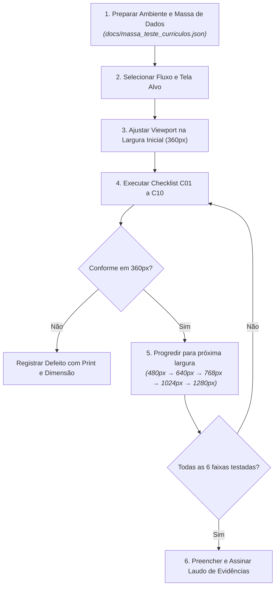

# Roteiro de Teste de Responsividade com Dispositivos F1.1

> **Documento Normativo Operacional — F9.6**  
> **Issue:** [#375](https://github.com/code-alchemists-br/sistema-curriculo/issues/375) — `[F9.6] Criar roteiro de teste de responsividade com dispositivos definidos em F1.1`  
> **Requisito Não Funcional:** RNF03 — Compatibilidade e adaptação da interface  
> **Especificação Base:** [docs/compatibilidade-responsividade.md](file:///home/minoru/projetos/sistema-curriculo/docs/compatibilidade-responsividade.md) (F1.1 / #168)  
> **Análise Decisória:** [prompts/frontend/20261026-080500-roteiro-teste-responsividade-f1-1-v001.md](file:///home/minoru/projetos/sistema-curriculo/prompts/frontend/20261026-080500-roteiro-teste-responsividade-f1-1-v001.md)  
> **Responsável:** Gustavo Minoru Haga (`@minoruhaga`)  
> **Data de Homologação:** 26/10/2026  

---

## 1. Objetivo e Aplicação

Este documento estabelece o **Procedimento Operacional Padrão (POP)** para a execução, verificação e registro de testes de responsividade em todas as interfaces do **Sistema Currículo**. 

O roteiro traduz as diretrizes normativas de compatibilidade e adaptação de tela de **F1.1** em passos práticos e reprodutíveis, permitindo que desenvolvedores, homologadores e revisores apliquem os mesmos critérios para validar que as telas funcionam com integridade visual e funcional em smartphones, tablets e computadores.

---

## 2. Matriz de Dispositivos e Larguras de Referência (F1.1)

A avaliação de responsividade é estritamente balizada pelas 6 larguras de referência definidas no projeto:

| Faixa / Categoria | Largura de Teste | Dispositivos Físicos e Emuladores Típicos | Breakpoint CSS Relevante | Objetivo Principal da Inspeção |
| :--- | :---: | :--- | :--- | :--- |
| **Mobile Compacto** | `360 px` | Samsung Galaxy A/S compactos, Moto G pequeno | Menor que `30rem` (480px) | Verificar o limite inferior suportado, alinhamento vertical e ausência de scroll horizontal |
| **Mobile Médio** | `480 px` | iPhone 14/15/16 Pro Max, Pixel 8 em modo retrato | Limiar exato de `30rem` (480px) | Validar transição fluida de componentes de formulários e cabeçalhos compactos |
| **Mobile Amplo / Compacto** | `640 px` | Smartphones dobráveis (Fold aberto), Celulares em paisagem | Limiar exato de `40rem` (640px) | Avaliar transição entre empilhamento coluna única e início de layouts bi-coluna |
| **Tablet** | `768 px` | iPad Mini, iPad 10.2", Galaxy Tab A | Superior a `40rem` (640px) | Verificar aproveitamento do espaço útil sem esticar campos excessivamente |
| **Desktop Compacto** | `1024 px` | iPad Pro 12.9", Laptops compactos (11"-13") | Início de visualização Desktop | Validar contenção em `max-width`, centralização de conteúdo e margens automáticas |
| **Desktop Padrão / Amplo**| `1280 px+`| Monitores Full HD (1920x1080), Monitores ultrawide | Resoluções amplas | Garantir que o design não degrade em telas ultra-largas e mantenha ergonomia de leitura |

> [!IMPORTANT]
> **Largura Mínima Estrita:** A menor largura formalmente suportada pelo Sistema Currículo é **360 px**. Resoluções inferiores a 360 px não constituem critério obrigatório de homologação contratual, embora a interface deva manter degradação suave quando possível.

---

## 3. Matriz de Navegadores Homologados

Os testes devem ser conduzidos prioritariamente nas duas versões estáveis mais recentes dos seguintes motores de renderização:

1. **Chromium Engine:** Google Chrome e Microsoft Edge (Desktop e Android).
2. **Gecko Engine:** Mozilla Firefox (Desktop e Android).
3. **WebKit Engine:** Apple Safari (macOS e iOS / iPadOS).

---

## 4. Ambiente e Ferramental de Teste

### 4.1 Emulação via DevTools (Inspeção Rápida no Desenvolvimento)

1. Abrir a aplicação em execução local (`npm run dev`) em navegador baseado em Chromium ou Firefox.
2. Pressionar `F12` ou `Ctrl+Shift+I` (`Cmd+Option+I` no macOS) para abrir as Ferramentas do Desenvolvedor.
3. Ativar o **Device Mode / Modo de Dispositivo Responsivo** (`Ctrl+Shift+M` ou `Cmd+Shift+M`).
4. Selecionar a opção de dimensionamento **"Responsive" (Responsivo)**.
5. Inserir manualmente cada uma das larguras da matriz: `360`, `480`, `640`, `768`, `1024` e `1280` px (com altura recomendada de `800 px` ou superior).
6. Configurar o **Device Pixel Ratio (DPR)** para `2.0` ou `3.0` nas resoluções móveis para avaliar a nitidez tipográfica e alinhamentos de bordas.
7. Alternar a orientação entre **Retrato (Portrait)** e **Paisagem (Landscape)** para verificar o comportamento dinâmico.

### 4.2 Teste em Dispositivo Físico Real (Homologação de Aceite)

1. Conectar o dispositivo móvel à mesma rede local do servidor de desenvolvimento ou utilizar a URL de homologação.
2. Navegar pelo fluxo utilizando toques reais na tela, avaliando o comportamento do teclado virtual nativo ao focar campos de texto.
3. Verificar a sensibilidade táctil de botões e links de navegação.

---

## 5. Fluxos Prioritários do Sistema

A verificação de responsividade deve cobrir obrigatoriamente os seguintes fluxos essenciais:

1. **Fluxo de Acesso e Perfil:**
   - Tela de Login e Cadastro (`PaginaAcessoEstudante`).
   - Tela de Edição de Dados Pessoais e Contatos (`PaginaDadosPessoais`).
   - Telas de Cadastro de Itens de Currículo: Formação Acadêmica, Experiência Profissional, Projetos Acadêmicos, Competências, Idiomas e Documentos.
2. **Fluxo de Visualização e Prévia do Currículo:**
   - Prévia nos modelos `ModeloClassico` e `ModeloCompacto`.
   - Alternância dinâmica entre modelos de layout.
   - Apresentação de estados vazios (`EstadoVazioSecao`) quando seções não possuem itens.
3. **Fluxo de Oportunidades e Vagas:**
   - Listagem e busca de vagas (`PaginaVagasGrupo2`).
   - Apresentação de cards de vagas, filtros e estados vazios/erro.
4. **Fluxo de Exportação:**
   - Controles de download e geração de arquivos PDF e DOCX.

---

## 6. Checklist Operacional de Aceitação (10 Critérios)

Durante o teste em cada resolução e fluxo, o avaliador deve checar os 10 critérios objetivos abaixo. Qualquer item marcado como **Não Conforme** impede a aprovação:

| Código | Critério de Aceitação | Condição de Aprovação (Passa) | Sinal de Falha (Reprova) |
| :---: | :--- | :--- | :--- |
| **C01** | **Scroll Horizontal** | A página rola exclusivamente na vertical. | Barra de rolagem horizontal visível no body ou elementos vazando a viewport. |
| **C02** | **Legibilidade do Texto** | Tipografia legível, com tamanho mínimo de corpo de `14px` (0.875rem) e contraste adequado. | Textos truncados sem elipse, letras comprimidas ou fontes microscópicas. |
| **C03** | **Ausência de Sobreposição** | Nenhum elemento ou texto sobrepõe outro controle de forma indevida. | Títulos cobrindo botões, ícones sobrepondo textos ou linhas colidindo. |
| **C04** | **Quebra de Palavras e URLs** | Textos longos, e-mails e links quebram com `overflow-wrap: break-word`. | Links extensos empurrando a borda direita da tela para além da viewport. |
| **C05** | **Área de Toque Útil** | Botões e alvos de interação possuem área mínima de clique de `44x44 px` ou espaçamento seguro. | Botões colados impossibilitando o toque isolado em telas sensíveis ao toque. |
| **C06** | **Disponibilidade de Ações** | Botões primários ("Salvar", "Avançar", "Exportar") permanecem visíveis e operáveis. | Ações essenciais ocultas ou empurradas para fora da área útil sem rolagem. |
| **C07** | **Preservação de Conteúdo** | Nenhum dado essencial é ocultado exclusivamente devido à redução da tela. | Remoção arbitrária de campos de dados pessoais ou descrições no mobile. |
| **C08** | **Transição nos Breakpoints** | Layout se reorganiza de forma limpa nos limiares de `30rem` (480px) e `40rem` (640px). | Layout quebrado exatamente nos pontos de corte dos seletores de mídia. |
| **C09** | **Navegação por Teclado** | O foco visual permanece visível e segue uma ordem lógica de tabulação. | Indicador de foco oculto (`outline: none`) ou armadilha de foco em componentes. |
| **C10** | **Integridade de Negócio** | Todas as validações de formulário e mensagens de feedback funcionam identicamente. | Mensagens de erro de validação deformando o formulário ou inacessíveis. |

---

## 7. Procedimento Passo a Passo de Execução



### Passo 1: Preparação do Cenário
- Carregar o sistema com a massa de dados representativa do projeto ([docs/massa_teste_curriculos.json](file:///home/minoru/projetos/sistema-curriculo/docs/massa_teste_curriculos.json)), garantindo que existam currículos preenchidos com seções completas e textos representativos.

### Passo 2: Execução Sequencial por Faixa de Largura
- Iniciar a inspeção na menor largura obrigatória (**360 px**).
- Rolar a página de cima a baixo, preencher formulários, abrir modais e alternar seletores.
- Incrementar a largura gradualmente até atingir cada um dos marcos: **480 px**, **640 px**, **768 px**, **1024 px** e **1280 px**.
- Observar atentamente o comportamento do layout exatamente nos pontos de corte (`480px` e `640px`).

### Passo 3: Classificação de Falhas (Se houver)
- **Crítica:** Quebra estrutural com scroll horizontal no body ou impossibilidade de completar a ação principal.
- **Maior:** Texto sobreposto, controle de clique inacessível ou quebra indevida de dados.
- **Menor:** Espaçamento assimétrico ou desalinhamento estético que não prejudica leitura ou uso.

### Passo 4: Registro de Evidências
- Preencher o relatório formal na pasta `docs/testes/evidencias/` seguindo o modelo do item 8 deste roteiro.

---

## 8. Modelo Padronizado de Relatório de Evidências

Todo ensaio de responsividade formalizado no projeto deve registrar seu laudo utilizando o template abaixo:

```markdown
# Registro de Evidências: Responsividade de [Nome da Tela / Funcionalidade]

- **Issue:** [#[Número]](https://github.com/code-alchemists-br/sistema-curriculo/issues/[Número]) — [Título da Issue]
- **Requisito Não Funcional:** RNF03
- **Roteiro Base:** docs/testes/roteiro-teste-responsividade-f1-1.md
- **Responsável:** [Nome e @username]
- **Data da Avaliação:** DD/MM/AAAA

## 1. Tabela de Conformidade por Resolução

| Faixa F1.1 | Largura Testada | Scroll Horizontal (C01) | Legibilidade (C02-C04) | Alvos e Ações (C05-C07) | Breakpoint (C08) | Veredito |
| :--- | :---: | :---: | :---: | :---: | :---: | :---: |
| **Mobile Compacto** | `360 px` | Conforme | Conforme | Conforme | Conforme | **Aprovado** |
| **Mobile Médio** | `480 px` | Conforme | Conforme | Conforme | Conforme | **Aprovado** |
| **Mobile Amplo** | `640 px` | Conforme | Conforme | Conforme | Conforme | **Aprovado** |
| **Tablet** | `768 px` | Conforme | Conforme | Conforme | Conforme | **Aprovado** |
| **Desktop Compacto**| `1024 px` | Conforme | Conforme | Conforme | Conforme | **Aprovado** |
| **Desktop Amplo** | `1280 px` | Conforme | Conforme | Conforme | Conforme | **Aprovado** |

## 2. Catálogo de Comportamentos Observados
- [Descrever como os componentes se adaptaram, padding aplicado e comportamento de colunas]

## 3. Conclusão e Handoff
- [Declaração formal de atendimento ao RNF03 e F1.1]
```

---

## 9. Rastreabilidade com a Matriz de Testes

- **WBS:** `1.7.1.*`, `1.7.2.*`, `1.8.1.*`
- **Requisitos Vinculados:** `RNF03` (Compatibilidade e adaptação), `RF06` (Modelos), `RF07` (Prévia), `RF11` (Vagas)
- **Cards Relacionados:** #168 (F1.1), #375 (F9.6), #366 (F8.10), #409 (F11.11), #220 (F5.12), #219 (F5.11), #376 (F9.7), #379 (F9.9)
